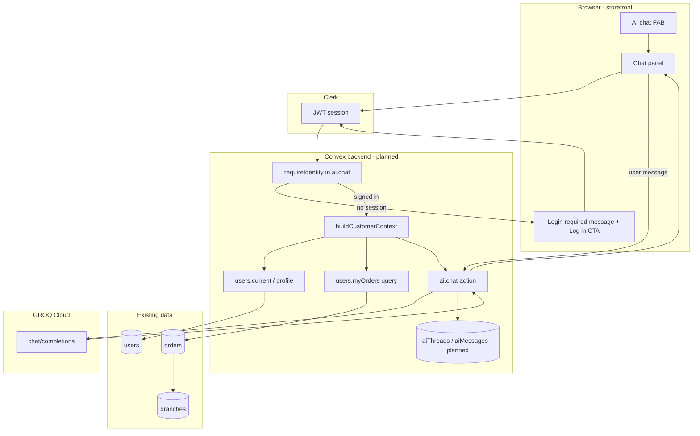
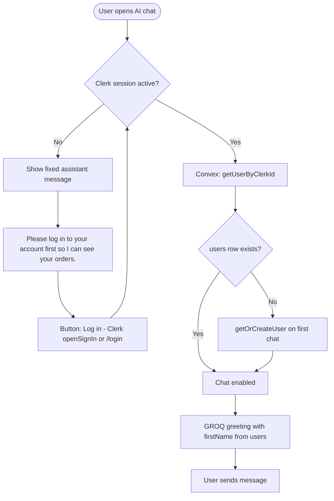
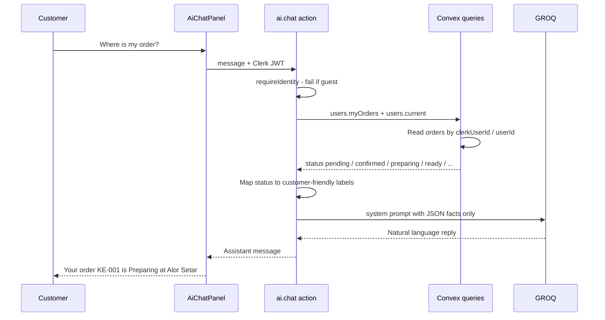
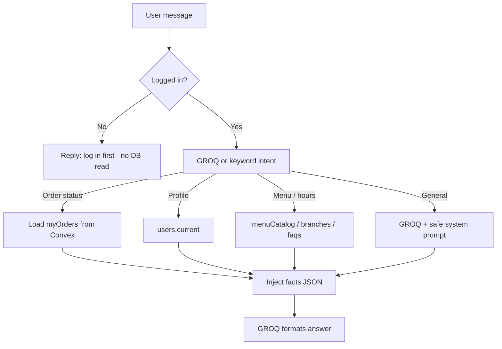
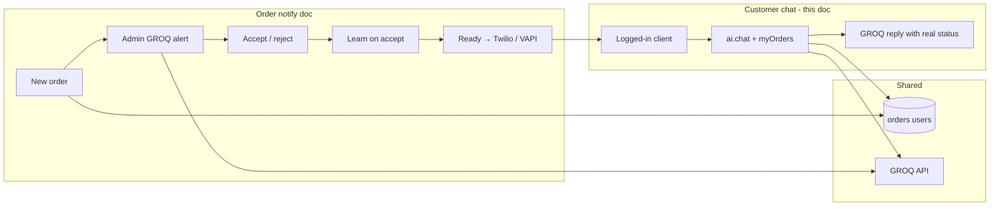

# AI customer chat system (design only)

> **Status:** Specification and diagrams only — **not implemented.**  
> Companion to [AI_ORDER_NOTIFICATION_SYSTEM.md](AI_ORDER_NOTIFICATION_SYSTEM.md) (admin alerts + Twilio/VAPI).

This document covers the **storefront AI chat**: a logged-in **client** can ask questions; the assistant answers with **real data** from Convex (orders, profile, branch) — not guesses.

---

## Rules (non‑negotiable)

| Rule | Behavior |
|------|----------|
| **Login first** | No Clerk session → AI **must not** read or reveal any user’s orders. Reply: *“Please log in to your account first.”* + sign-in button. |
| **Client only** | Identity is **Clerk customer** (`ctx.auth.getUserIdentity()`), mapped to `users` via `clerkUserId`. Admin `adminToken` is a **separate** surface (optional admin chat later). |
| **Truth from DB** | Order status, numbers, totals, branch come from **`users.myOrders`** and related queries — GROQ only **phrases** the facts. |
| **Own data only** | Context is scoped to the **signed-in** user’s rows; never another customer’s orders. |

---

## System diagram (customer AI chat)



---

## Login gate flow

Every chat request goes through the server. The UI may hide the input for guests, but **Convex enforces** auth.



**Guest — allowed (optional v1):** generic café FAQ (hours, location) **without** order lookup — if you want this, use a **separate** `ai.chatGuest` with **no** `orders` in context. Default design: **order questions require login only.**

---

## Order status chat flow (real backend data)

When the user asks about their order (*“Is my order ready?”*, *“What’s the status?”*):



### Status mapping (DB → what AI tells the user)

Stored in `orders.status` (see `convex/lib/orderStatusFlow.ts`). AI uses **these labels** in replies:

| `orders.status` | Customer-facing label | Meaning for chat |
|-----------------|----------------------|------------------|
| `pending` | Pending | Placed; waiting for café to accept |
| `confirmed` | Accepted | Staff accepted; not cooking yet |
| `preparing` | Preparing | Kitchen is working on it |
| `ready` | Ready for pickup | Can collect at branch |
| `completed` | Delivered | Picked up / done |
| `cancelled` | Cancelled | Stopped; may include reason |

**Data source today (already in codebase):** `users.myOrders` — returns the signed-in customer’s orders sorted by pipeline stage.

**Planned chat action (sketch):**

1. `requireIdentity(ctx)` — if missing → throw `UNAUTHENTICATED` → UI shows login message.  
2. Run same logic as `myOrders` inside `buildCustomerContext`.  
3. Pass **structured facts** into GROQ system prompt, e.g.:

```json
{
  "activeOrders": [
    {
      "orderNumber": "KE-20250602-003",
      "status": "preparing",
      "statusLabel": "Preparing",
      "branch": "Alor Setar",
      "total": 24.5,
      "currency": "MYR"
    }
  ]
}
```

4. Instruct GROQ: *“Only state facts present in `activeOrders`. If empty, say they have no active orders.”*

---

## Intent routing (planned)



| User might ask | Backend reads | Example reply (planned tone) |
|----------------|---------------|------------------------------|
| “Where is my order?” | Latest non-terminal `myOrders` | *“Your order **#KE-003** is **Preparing** at **Alor Setar**.”* |
| “Do I have any orders?” | Full `myOrders` active set | Lists each active order with status |
| “Is it ready yet?” | Same | *“Not yet — status is **Preparing**.”* or *“Yes — **Ready for pickup**.”* |
| “What did I order?” | Order line items from `orders` | Item names and quantities from DB |

---

## Combined AI system (chat + order notify)

How customer **chat** fits with admin **notify** pipeline:



When staff mark an order **ready**, the customer may learn via:

- **Twilio / VAPI** (external), and/or  
- **In-app** proactive message in the same chat thread *(planned)*.

Both use the same **`orders.status === "ready"`** fact from the database.

---

## Planned components

| Piece | Location *(planned)* | Role |
|-------|----------------------|------|
| `AiChatFab` | `src/components/ai/AiChatFab.tsx` | Open chat |
| `AiChatPanel` | `src/components/ai/AiChatPanel.tsx` | Messages + input |
| `AiLoginGate` | `src/components/ai/AiLoginGate.tsx` | Guest state UI |
| `useAiChat` | `src/hooks/useAiChat.ts` | Calls `api.ai.chat` |
| `convex/ai/chat.ts` | action | Auth + context + GROQ |
| `convex/ai/context.ts` | helper | `buildCustomerContext` → `myOrders` data |

### Error handling (planned)

| Case | User sees |
|------|-----------|
| Not logged in | *“Please log in to your account first.”* |
| Logged in, no orders | *“You don’t have any active orders right now.”* |
| GROQ / network error | *“I couldn’t reach the assistant. Try again in a moment.”* |
| Rate limited | *“Too many messages. Please wait a minute.”* |

---

## Security (planned)

- **JWT required** on every `ai.chat` call (`requireIdentity`).  
- Context builder loads orders **only** for `identity.subject` (same rules as `users.myOrders`).  
- Do **not** send other users’ PII to GROQ.  
- `GROQ_API_KEY` only in Convex — never `VITE_`.  
- Log prompts without full phone/email in production logs (redact).

---

## Implementation phases (customer chat)

| Phase | Deliverable |
|-------|-------------|
| **1** | Chat UI + login gate (no GROQ; static “log in first”) |
| **2** | `ai.chat` + `myOrders` facts → templated replies (no GROQ) |
| **3** | GROQ phrasing with strict “facts JSON” system prompt |
| **4** | Thread history (`aiMessages`) |
| **5** | Proactive inject when order status changes (subscribe or push) |

---

## Related docs

- [README — GROQ AI assistant](../README.md#planned-groq-ai-assistant-design-only)
- [AI_ORDER_NOTIFICATION_SYSTEM.md](AI_ORDER_NOTIFICATION_SYSTEM.md) — admin + Twilio/VAPI
- [Order status workflow](../README.md#order-status-workflow)
