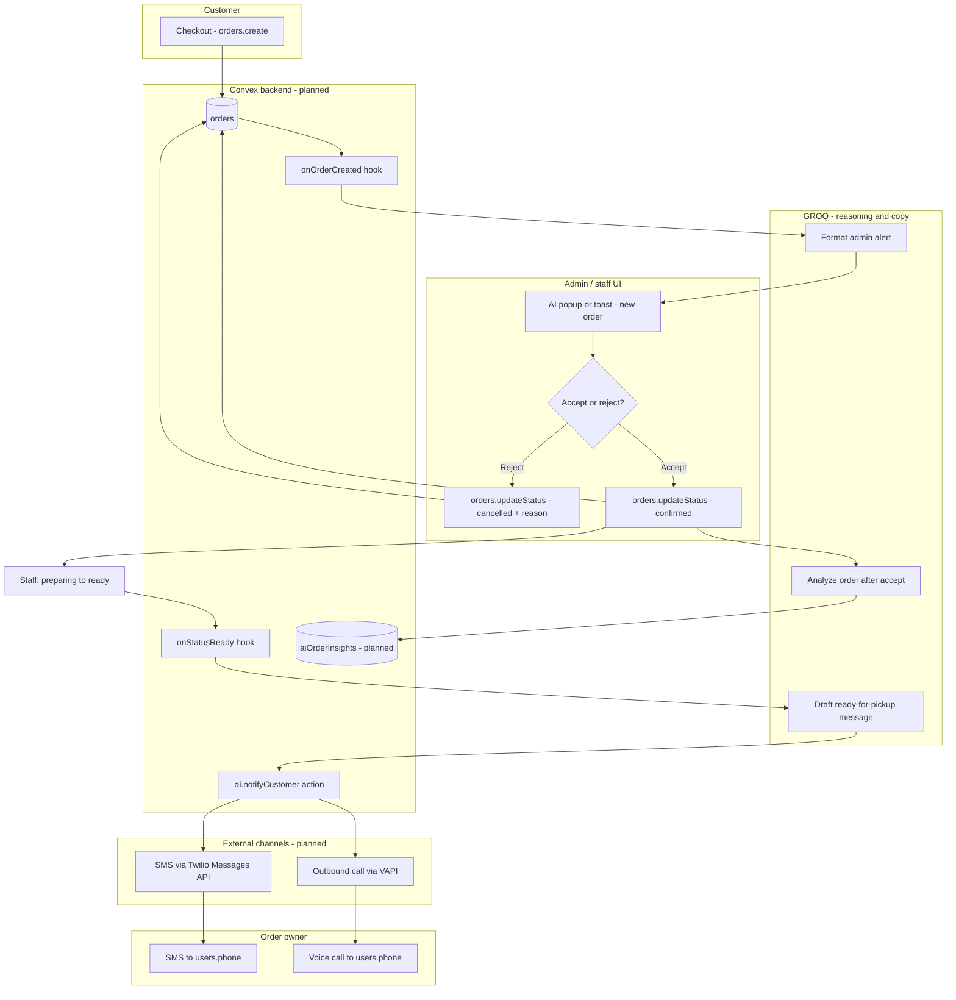
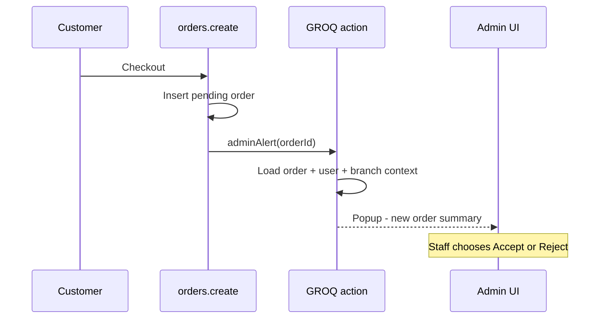
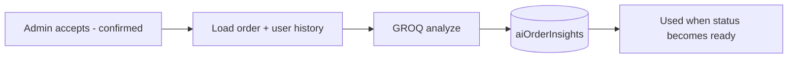
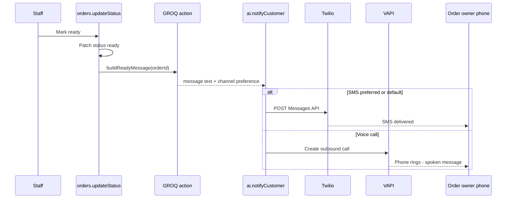
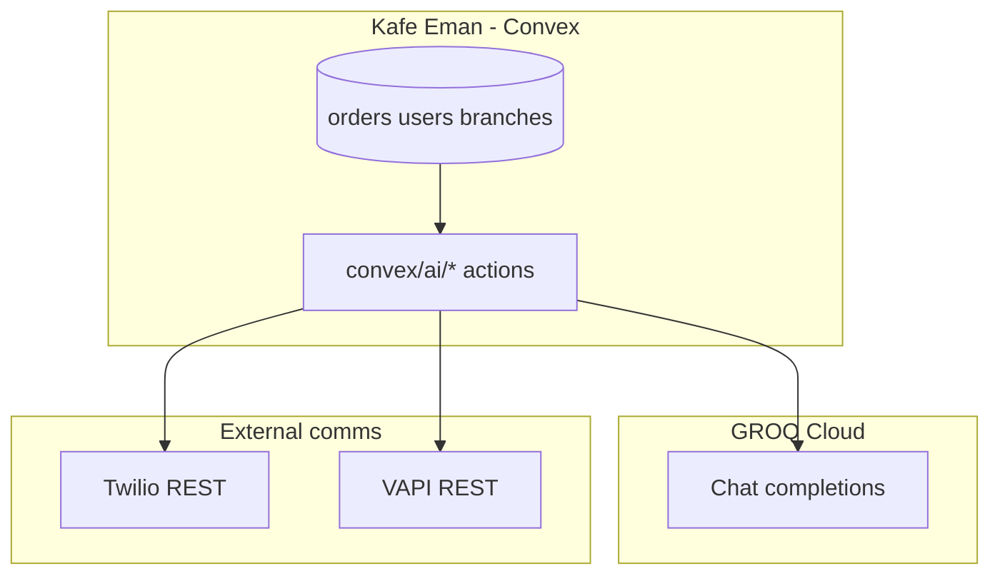

# AI order notification system (design only)

> **Status:** Specification and diagrams only — **not implemented.**  
> Build this when you wire GROQ, Twilio, and VAPI into Convex.

This document describes the **order-driven AI orchestration** you planned:

1. **GROQ** informs admin/staff when a new order arrives.
2. Admin **accepts** or **rejects** the order.
3. If **accepted** → AI **analyzes** the order and **learns** (stores context for later messages).
4. When the order is **ready** → notify the **order owner** by **SMS (Twilio)** and/or **voice call (VAPI)**.

In-app chat toasts (customer/admin UI) remain optional extras from the main [README](../README.md#planned-groq-ai-assistant-design-only); this doc focuses on the **external notification pipeline**.

---

## Master flow (your planned diagram)

---

## Phase 1 — New order → inform admin

| Step | Actor | Action |
|------|--------|--------|
| 1 | Customer | Completes checkout → `orders.create` inserts row (`status: pending`) |
| 2 | Convex | Scheduled function or mutation follow-up reads order + `users` + `branches` |
| 3 | GROQ | Builds short alert (customer name, branch, items, total, order number) |
| 4 | Admin UI | Popup/toast with **Accept** and **Reject** (reject = cancel with reason, same as today’s admin flow) |

**Important:** AI does **not** auto-accept orders. Staff (or admin UI buttons) call existing `orders.updateStatus` — same rules as `orderStatusFlow` (`pending` → `confirmed` or `cancelled`).

---

## Phase 2 — Accept → analyze and learn

When staff **accepts** (`pending` → `confirmed`):

| Step | What happens |
|------|----------------|
| 1 | `orders.updateStatus` patches order (existing MVP) |
| 2 | Convex triggers `ai.onOrderAccepted` *(planned)* |
| 3 | GROQ receives structured payload: items, modifiers, branch, customer history snippet, time of day |
| 4 | GROQ returns **insights** (not shown raw to customer): prep hints, preferred phrasing, risk flags (allergies if you add them later) |
| 5 | Persist to `aiOrderInsights` keyed by `orderId` + `userId` for reuse when order hits `ready` |

**What “learn” means in v1 (design):**

- **Per order:** snapshot of GROQ analysis after accept (prep time estimate text, tone, item summary).
- **Per customer (optional v2):** append to `users.aiPreferences` — e.g. “usually orders oat latte”, “prefers SMS over call”.
- **Not** fine-tuning the GROQ model — only **context stored in Convex** and injected into later prompts.

---

## Phase 3 — Ready → notify owner (Twilio + VAPI)

When staff marks order **ready** (`preparing` → `ready`):

| Step | What happens |
|------|----------------|
| 1 | `orders.updateStatus` patches to `ready` |
| 2 | Convex loads `users.phone`, `aiOrderInsights`, order summary |
| 3 | GROQ drafts final customer message (name, branch, order #, pickup window) |
| 4 | **Twilio** sends SMS (primary for most users) |
| 5 | **VAPI** places outbound call with TTS or assistant script *(optional / fallback / user preference)* |

### Channel selection (planned rules)

| Condition | Channel |
|-----------|---------|
| `users.notifyChannel === "sms"` | Twilio only |
| `users.notifyChannel === "call"` | VAPI only |
| `users.notifyChannel === "both"` | SMS first, call if SMS fails *(or parallel — your choice at implement time)* |
| Missing phone | Skip external notify; log + in-app toast only |
| Rejected / cancelled order | **No** ready notification |

---

## Component responsibilities

| Layer | Role | Technology |
|-------|------|------------|
| **Brain** | Wording, analysis, learning summaries | **GROQ** (`/chat/completions` from Convex actions) |
| **SMS** | Text to order owner | **Twilio** Programmable Messaging |
| **Voice** | Call order owner with spoken update | **VAPI** outbound API |
| **Orchestration** | Auth, DB, when to trigger | **Convex** actions + internal mutations |
| **Human gate** | Accept / reject / mark ready | **Admin UI** + existing `orders.updateStatus` |

---

## Planned Convex modules (file sketch)

| File | Type | Purpose |
|------|------|---------|
| `convex/ai/adminAlert.ts` | action | GROQ text for new-order popup |
| `convex/ai/onOrderAccepted.ts` | internal action | Analyze + write `aiOrderInsights` |
| `convex/ai/notifyCustomer.ts` | action | GROQ message + Twilio/VAPI dispatch |
| `convex/ai/context.ts` | helpers | Build prompt from `users` + `orders` |
| `convex/ai/channels/twilio.ts` | helper | Send SMS (server-only credentials) |
| `convex/ai/channels/vapi.ts` | helper | Start outbound call |
| `convex/schema.ts` | tables | `aiOrderInsights`, `aiNotificationLog` |

### Planned tables

**`aiOrderInsights`** *(planned)*

| Field | Type | Notes |
|-------|------|-------|
| `orderId` | `Id<"orders">` | Unique per order |
| `userId` | `Id<"users">` | Order owner |
| `acceptedAt` | `number` | Timestamp |
| `analysisJson` | `string` | GROQ structured output (prep notes, tone) |
| `groqModel` | `string` | Audit |

**`aiNotificationLog`** *(planned)*

| Field | Type | Notes |
|-------|------|-------|
| `orderId` | `Id<"orders">` | |
| `channel` | `"sms" \| "call"` | |
| `provider` | `"twilio" \| "vapi"` | |
| `externalId` | `string` | Twilio SID / VAPI call id |
| `status` | `"queued" \| "sent" \| "failed"` | |
| `error` | optional `string` | |

---

## Environment variables (planned)

Set on **Convex** only (never `VITE_`):

| Variable | Service |
|----------|---------|
| `GROQ_API_KEY` | GROQ |
| `GROQ_MODEL` | e.g. `llama-3.3-70b-versatile` |
| `TWILIO_ACCOUNT_SID` | Twilio |
| `TWILIO_AUTH_TOKEN` or API key | Twilio |
| `TWILIO_MESSAGING_FROM` | E.164 sender or Messaging Service SID |
| `VAPI_API_KEY` | VAPI |
| `VAPI_PHONE_NUMBER_ID` | Outbound caller ID in VAPI |
| `VAPI_ASSISTANT_ID` | Optional — scripted “order ready” assistant |

Optional on `users` *(schema addition later)*:

| Field | Purpose |
|-------|---------|
| `notifyChannel` | `"sms"` \| `"call"` \| `"both"` |
| `phoneVerified` | Only notify if true |

---

## Security and compliance (planned)

- GROQ, Twilio, and VAPI secrets **only** in Convex environment.
- Validate **E.164** phone before send; respect `phoneVerified`.
- **TCPA / consent:** transactional “order ready” SMS generally allowed for existing customers who provided phone at checkout — document consent in Terms (see legal pages).
- **Webhook signatures:** verify Twilio and VAPI callbacks if you track delivery status.
- Rate-limit GROQ calls per order event to control cost.
- Log all outbound attempts in `aiNotificationLog` for support debugging.

---

## Implementation phases (suggested)

| Phase | Deliverable |
|-------|-------------|
| **1** | Admin popup on new order (GROQ text only, no Twilio/VAPI) |
| **2** | Wire Accept/Reject to existing `updateStatus` + trigger `onOrderAccepted` learning |
| **3** | On `ready`, GROQ message + Twilio SMS |
| **4** | VAPI outbound call + channel preference on `users` |
| **5** | Delivery webhooks + `aiNotificationLog` + admin retry UI |

---

## Related docs

- [AI_CUSTOMER_CHAT_SYSTEM.md](AI_CUSTOMER_CHAT_SYSTEM.md) — logged-in client chat, order status from DB, login gate
- [README — GROQ AI assistant (chat UI)](../README.md#planned-groq-ai-assistant-design-only)
- [README — Order status workflow](../README.md#order-status-workflow)
- [convex/SCHEMA.md](../convex/SCHEMA.md) — current tables (AI tables not added yet)
